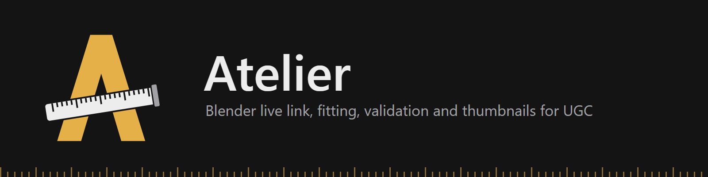

  

  <b>Atelier</b> is a Roblox Studio plugin for UGC creators. <b>Atelier Link</b> is its free Blender add-on. 
  Model in Blender, see it live in Studio, check it against Roblox's upload rules, frame the thumbnail, upload once.

  <a href="https://github.com/Sovereign3D/atelier-link/releases/latest"><b>Download Atelier Link for Blender</b></a>
  &nbsp;·&nbsp;
  <a href="https://create.roblox.com/store/asset/115510141417079"><b>Get Atelier for Roblox Studio</b></a>

---

## Contents

- [What you get](#what-you-get)
- [Requirements](#requirements)
- [Install the Blender add-on](#install-the-blender-add-on)
- [Get Atelier for Roblox Studio](#get-atelier-for-roblox-studio)
- [Connect Blender to Studio](#connect-blender-to-studio)
- [Live Link](#live-link)
- [Bounds](#bounds)
- [Validate](#validate)
- [Thumbnail](#thumbnail)
- [Spawn Kit in Blender](#spawn-kit-in-blender)
- [From preview to upload](#from-preview-to-upload)
- [Troubleshooting](#troubleshooting)
- [FAQ](#faq)
- [Privacy and safety](#privacy-and-safety)
- [Changelog](#changelog)
- [Licence](#licence)

---

## What you get

| Tab in Studio | What it does |
|---|---|
| **Live Link** | Edit in Blender and the mesh updates in Studio about half a second later, texture included. Drag the preview anywhere, or bind it to an Accessory you already made. |
| **Bounds** | Roblox's official size box for every accessory type and body scale, plus triangle counts, so you know an item fits before you upload. |
| **Validate** | Checks your Accessory against Roblox's upload rules before you pay. Shows each problem on the item itself in the viewport and tells you how to fix it in Blender. Safe fixes are one click. |
| **Thumbnail** | Frame the Marketplace icon in the viewport with a live preview and a meter that turns green when the item fills the icon. |

The Blender add-on (this repository) is only needed for **Live Link** and **Spawn Kit**. Bounds, Validate and
Thumbnail work in Studio on their own.

## Requirements

- **Blender 2.93 or newer** (tested on Blender 5.1).
- **Roblox Studio** with the Atelier plugin.
- Windows or macOS. Blender and Studio run on the same computer.

## Install the Blender add-on

1. Open the [latest release](https://github.com/Sovereign3D/atelier-link/releases/latest) and download
   `atelier_link-x.x.x.zip`. **Don't unzip it.**
2. Install it in Blender:

| Your Blender | Steps |
|---|---|
| **4.2 and newer** | Edit > Preferences > **Get Extensions** > the small arrow at the top right > **Install from Disk** > pick the zip |
| **2.93 to 4.1** | Edit > Preferences > **Add-ons** > **Install** > pick the zip > tick **Atelier Link** |

3. In the 3D Viewport press **N** and open the **Atelier** tab. You'll see the **Atelier Link** and **Spawn Kit**
   panels.

To update, install the new zip the same way. To remove it, open Preferences, find Atelier Link and click
Uninstall (or Remove).

## Get Atelier for Roblox Studio

Atelier is on the Roblox Creator Store: **[get Atelier](https://create.roblox.com/store/asset/115510141417079)**.

1. Open the Atelier page on the Creator Store and click **Get**.
2. In Studio open the **Plugins** tab. The Atelier button is on the toolbar. Click it to open the panel.

## Connect Blender to Studio

Do this once per session.

1. **Blender:** select the mesh you want to preview (or set **Source** to a collection) and press **Start Link**.
   A 6-digit **pair code** appears, with the port (34873 by default).
2. **Studio:** open Atelier > **Live Link**, type the same port and pair code, press **Connect**.
3. The first time, Studio asks whether Atelier may send requests to `127.0.0.1`. Click **Allow**. This is your own
   computer; nothing goes online.
4. The dot at the top right of the panel turns green and says **Linked**.

The pair code changes every time you press Start Link, so type the new one in Studio when that happens. Press
**New Code** in Blender if you want a fresh code without restarting.

## Live Link

- Edit as usual: move vertices, add modifiers, scale, paint the texture. Studio updates when you stop moving.
- **Push Now** (Blender) sends the current state right away.
- **Auto Sync** off = Studio only updates when you press Push Now.
- **Texture size** sets the preview texture resolution sent to Studio.
- **Placement > Preview:** the mesh shows up as a preview model. Drag it with Studio's Move tool, it stays there
  while you keep editing. **Move preview to selection** puts it next to whatever you have selected.
- **Placement > Bind to Accessory:** select an Accessory (or its Handle) in Studio and press Bind. Your Blender edit
  now shows on that real item, on its attachment, so you see it on a character.
- **Synced objects** lists every mesh being sent, with its triangle count.

The preview is only a preview: it is not saved into your place. For the final item, export FBX from Blender and
use Studio's Import 3D (see [From preview to upload](#from-preview-to-upload)).

## Bounds

1. Select an Accessory (or its Handle) in Studio and open **Bounds**.
2. The panel shows the item's size against Roblox's maximum for its type and body scale (**Classic**, **Normal**,
   **Slender**). Bars turn red when a side is too big.
3. Triangle meters show the count against Roblox's limit (4,000 for accessories).
4. Select a character instead to see the body part budgets.

**Spawn kit** (in the Bounds tab): pick the item type (Hat, Hair, Face, Neck, Shoulder, Front, Back, Waist, ...),
the body scale and the rig (R15 Blocky or R6), then **Spawn kit**. Atelier adds an official Roblox body with the
size box on the right attachment, next to your camera. Model or place your item inside the box.

## Validate

1. Select the Accessory and press **Check selected**.
2. You get a score (passed / total) and every finding grouped by **Fails**, **Warnings** and **Passed**:
   triangles, size, hierarchy, handle properties, attachments, attributes and tags, vertex colours, textures,
   skinning and the 4-bone limit, cage UVs, cage distance, clothing poking out of the cage, and more. Layered
   clothing gets its own set of cage checks.
3. **Fix** buttons apply safe fixes (anything removed is kept in **ServerStorage > Atelier Backup**).
   **Fix all safe** applies all of them at once. Every fix can be undone with Ctrl+Z.
4. Problems only Blender can fix (too many triangles, bad cage UVs, skinning) open **Fix in Blender** with the
   exact steps.
5. **Visualize in the viewport** draws the problems on the item: an outline in the result colour, the allowed size
   box (green) and the item's own box (red while it sticks out), the attachment axes, and a floating list of what's
   wrong. Move or scale the item and it updates live. For layered clothing it draws the cage and puts a red dot on
   every spot where the clothing pokes through.

Validate covers Roblox's documented technical rules. Roblox can still reject an item for moderation reasons (IP,
content) that a plugin can't judge, so let Roblox's own upload check run too.

## Thumbnail

1. Select the Accessory and open **Thumbnail**, then **Set thumbnail**.
2. The viewport becomes the square Marketplace shot. Right-drag to turn, WASD to move, scroll to zoom, or tap a
   preset angle.
3. The corner preview shows the real icon. The meter turns green when the item fills it properly.
4. **Save** stores it the same way Roblox's own thumbnail tool does. It can't be changed after upload.
   **Remove custom thumbnail** goes back to Roblox's default.

## Spawn Kit in Blender

In Blender's Atelier tab, **Spawn Kit** adds an official Roblox body plus the size box for your item type at the
3D cursor. Pick the type, body scale and rig, then **Spawn**. The body is downloaded from Roblox the first time
and cached after that. Model inside the box and your item will fit in Studio.

## From preview to upload

1. Model and texture in Blender with Live Link on, checking against the Spawn Kit box.
2. Export FBX from Blender (Apply Scalings = **FBX Unit Scale**).
3. In Studio: **Avatar > Import 3D**, then make the Accessory (Avatar > Accessory Fitting Tool).
4. Atelier **Bounds** and **Validate**: fix everything red, use **Visualize** to see where.
5. Atelier **Thumbnail**: frame the icon until the meter is green.
6. Upload with Roblox's own flow and let its validation run.

## Troubleshooting

| Problem | Fix |
|---|---|
| Studio says **Not linked** / can't connect | Press Start Link in Blender first, then check the port and pair code match exactly. |
| Studio never asked to allow `127.0.0.1` | Plugins tab > Manage Plugins > Atelier > allow HTTP requests to 127.0.0.1. |
| "Port in use" in Blender | Another program (or a second Blender) uses that port. Change **Port** in Blender and in Studio to the same new number. |
| Nothing updates | Make sure the mesh is selected (or in the chosen collection) and **Auto Sync** is on, or press **Push Now**. |
| Preview is huge or tiny | Set **Scale** to 1.0 (1 Blender unit = 1 stud). Apply the object's scale in Blender (Ctrl+A > Scale). |
| No texture in Studio | The material needs an Image Texture plugged into Base Color. Procedural textures aren't sent. |
| Spawn Kit fails | It downloads Roblox's body the first time: check your internet and try again. |
| The add-on doesn't show up | Blender 2.93 to 4.1: tick Atelier Link in Add-ons after installing. Then press N in the 3D Viewport. |

## FAQ

**Is the Blender add-on free?** Yes, and it always will be.

**Do I need Blender for Bounds, Validate and Thumbnail?** No. Only Live Link and Spawn Kit use Blender.

**Does it change my Blender file?** No. It only reads your meshes. Spawn Kit adds a body and a box, which you can delete.

**Does it work with layered clothing?** Yes. Validate has a full set of cage checks and draws the cage in the
viewport.

**Why not just use Roblox's tools?** Roblox's upload validation is free and you should still let it run. Atelier
tells you what's wrong before you pay, shows you where on the item, and tells you what to change in Blender.

## Privacy and safety

- The link listens on `127.0.0.1` only. Nothing on your network or the internet can reach it.
- It only reads: it sends mesh and texture data to Studio and can't change your Blender file or run anything.
- Every request needs the pair code, which changes each time you press Start Link.
- The only time the add-on goes online is Spawn Kit downloading Roblox's official body files the first time.
- The Studio plugin never loads code from the internet and never adds scripts to your items. Every change it makes
  can be undone with Ctrl+Z.

## Changelog

**1.0.1**: safer link. Web pages in a browser can't lock Studio out, and parallel wrong codes can't get past the lockout.

**1.0.0**: first release. Live Link with textures, Spawn Kit, installs on Blender 2.93 and newer.

## Licence

The Blender add-on is GPL-3.0-or-later (see [LICENSE](LICENSE)), as required for Blender add-ons. The Atelier
Studio plugin is sold separately on the Roblox Creator Store.
